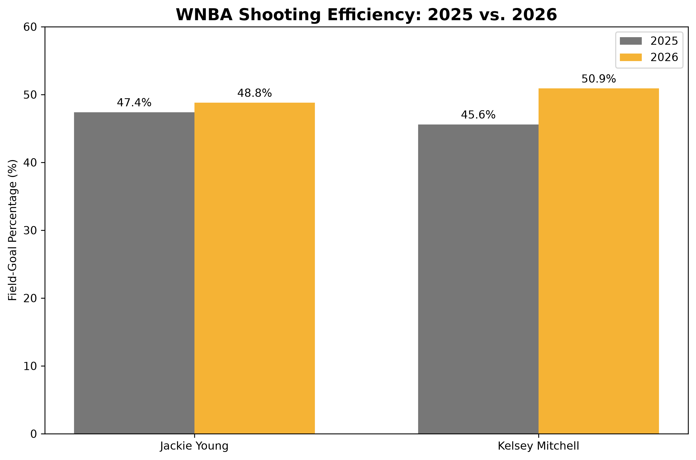
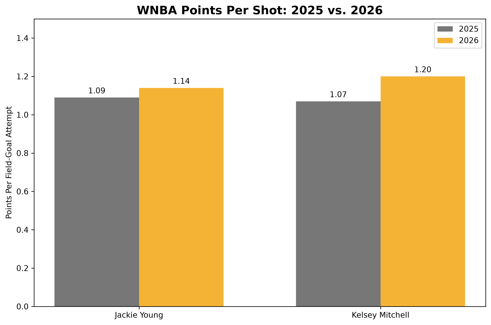
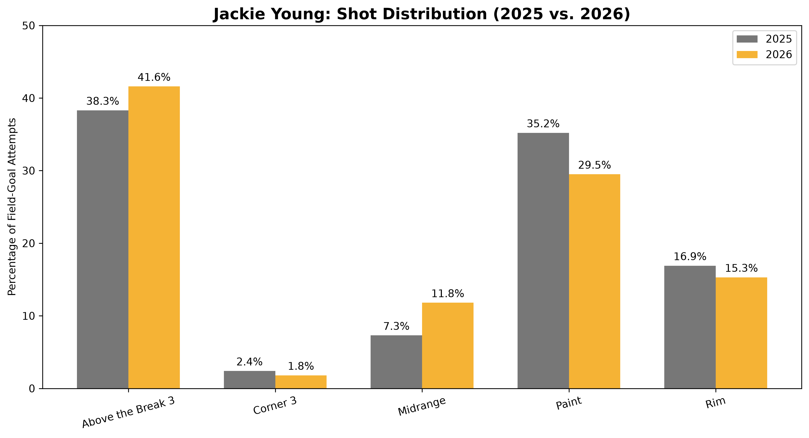
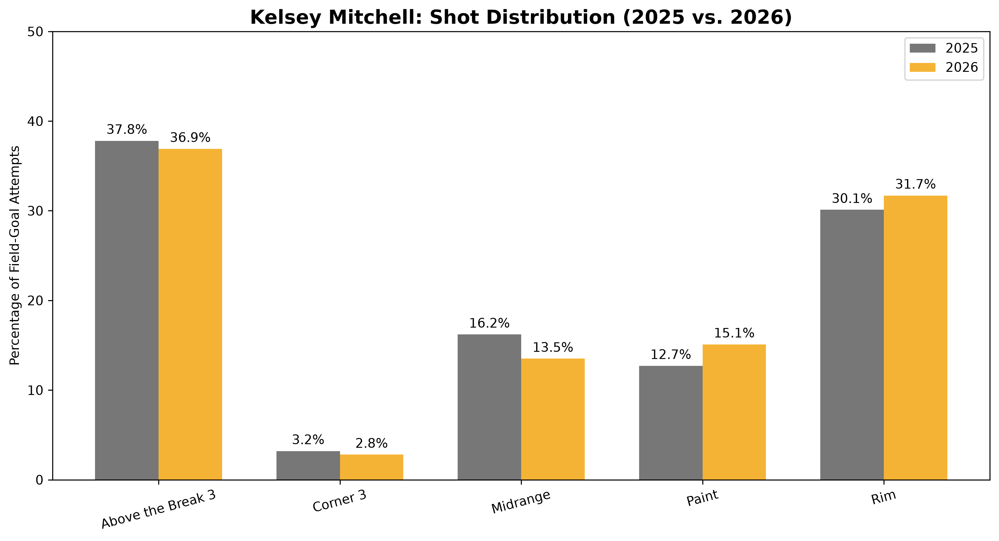
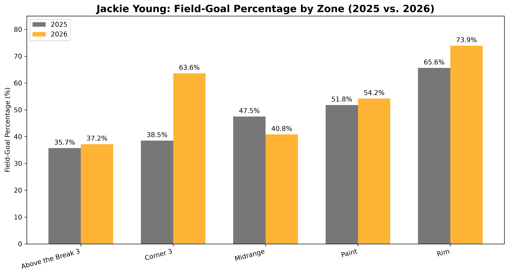
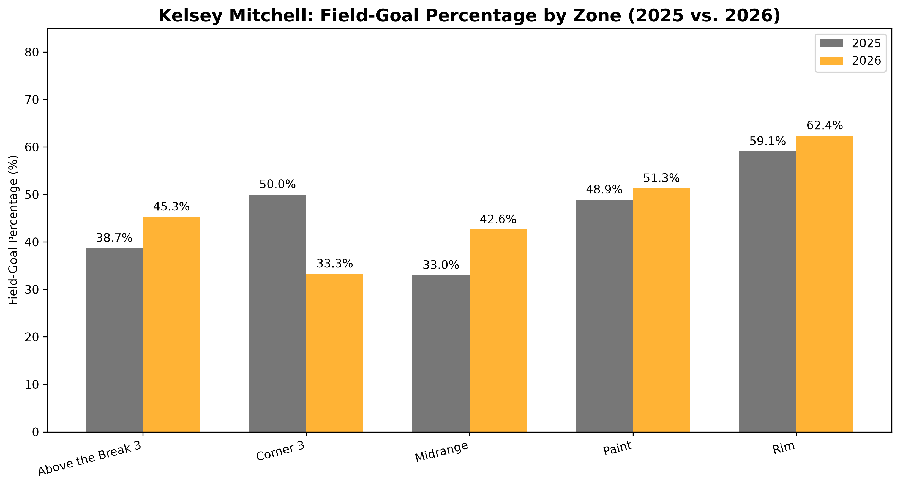
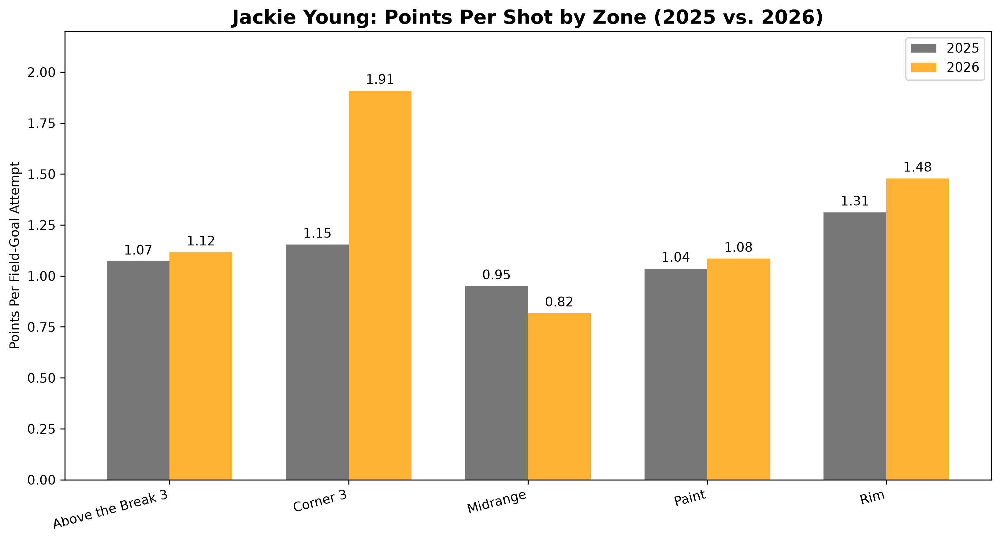
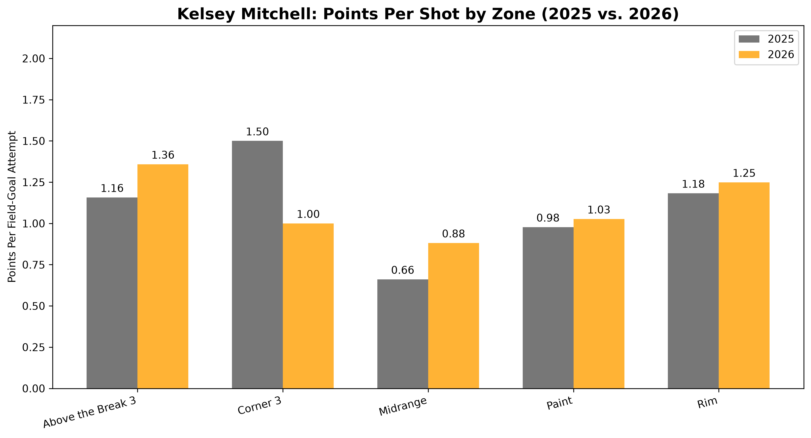
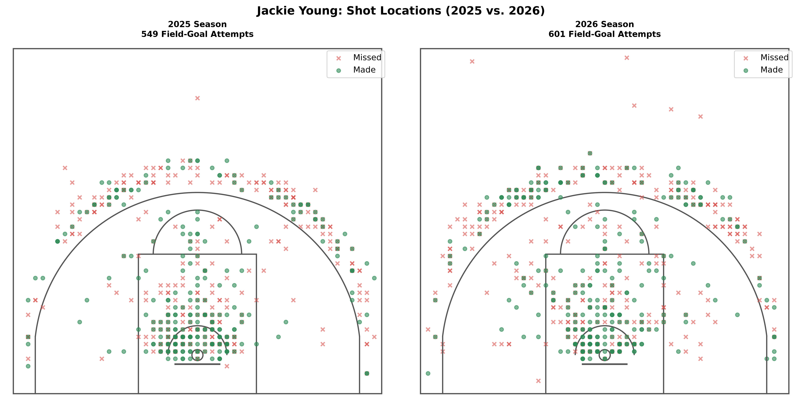
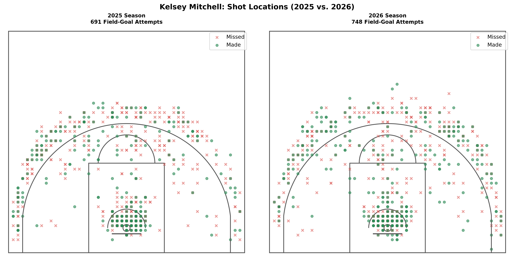

# WNBA Shot Profile Analysis | 2025 vs. 2026
**Kelsey Mitchell vs. Jackie Young**

## Project Overview
This project analyzes the year-over-year shooting performance of WNBA players Kelsey Mitchell and Jackie Young across the 2025 and 2026 seasons.

Using Python and play-by-play shot data, the analysis examines how each player's shot selection, field-goal efficiency, and scoring productivity changed between seasons.

The project combines statistical analysis with data visualization to identify trends in shooting performance and explore how shot location contributes to offensive efficiency.

## Research Questions

1. How did each player's overall field-goal percentage change from 2025 to 2026?

2. Which shooting zones experienced the greatest improvements or declines in efficiency?

3. How did each player's shot distribution change between seasons?

4. How did points per field-goal attempt change overall and across different shooting zones?

5. What do the shot-location visualizations reveal about each player's offensive tendencies?

## Tools and Technologies

- **Python:** Data processing, statistical analysis, and visualization

- **Pandas:** Data cleaning, filtering, grouping, and aggregation

- **NumPy:** Mathematical calculations and shot-distance analysis

- **Matplotlib:** Shooting efficiency charts, shot distribution comparisons, and shot-location visualizations

- **Visual Studio Code:** Development environment

- **Git and GitHub:** Version control and project documentation

## How to Run the Project

### 1. Clone the Repository

```bash
git clone https://github.com/answeat12-ship-it/WNBA-Shot-Profile-Analysis.git
```

### 2. Navigate to the Project Directory

```bash
cd WNBA-Shot-Profile-Analysis
```

### 3. Install Required Libraries

```bash
python3 -m pip install -r requirements.txt
```

### 4. Prepare the Data

Obtain the required WNBA shot-event and schedule datasets for both seasons.

Create a `data/` directory in the project folder and organize the files as follows:

```text
data/
├── shots_2025.csv
├── shots_2026.csv
├── wnba_schedule_2025.csv
└── wnba_schedule_2026.csv
```

Ensure that all filenames match exactly before running the analysis.

### 5. Run the Analysis

```bash
python3 shot_profile_analysis.py
```

The script calculates shooting statistics and generates visualizations comparing Kelsey Mitchell and Jackie Young across the 2025 and 2026 seasons.

## Data Source

The analysis uses WNBA shot-event and schedule data obtained through SportsDataverse, with underlying game information sourced from ESPN.

The dataset includes shot-event information for the 2025 and 2026 seasons, including player names, game identifiers, shot coordinates, shot outcomes, and scoring values.

The analysis focuses on two players:

- **Kelsey Mitchell**

- **Jackie Young**

Only field-goal attempts from qualifying regular-season games are included in the shooting calculations.

## Data Availability and Reproducibility

The analysis requires four CSV files:

| Filename | Description |
|---|---|
| `shots_2025.csv` | 2025 WNBA shot-event data |
| `shots_2026.csv` | 2026 WNBA shot-event data |
| `wnba_schedule_2025.csv` | 2025 WNBA schedule data |
| `wnba_schedule_2026.csv` | 2026 WNBA schedule data |

Place these files inside the `data/` directory.

The source datasets are not included in this repository and must be obtained separately.

The analysis uses consistent regular-season filters, shot-zone classifications, and shooting metrics to compare player performance across both seasons.

Generated charts are stored in the `visualizations/` directory.

## Data Cleaning and Preparation

Several data-cleaning procedures were performed before calculating shooting statistics.

1. **Combining Seasonal Data**

Shot-event and schedule datasets from 2025 and 2026 were combined into a single analytical dataset.

A season identifier was retained to distinguish between the two years and support year-over-year comparisons.

2. **Filtering Regular-Season Games**

Schedule records were filtered using the regular-season classification (season_type == 2).

Additional exclusions were applied to remove special-event games that should not contribute to regular-season shooting statistics.

2025 exclusion:

Commissioner's Cup championship game, ID 401736430

2026 exclusions:

Commissioner's Cup championship, Liberty vs. Aces, ID 401857321

All-Star Game, Team Coop, ID 401857320

The analysis also excludes All-Star team records where applicable.

3. **Identifying Field-Goal Attempts**

Free-throw events were excluded to isolate field-goal attempts.

The resulting dataset contains:

| Player | 2025 Games | 2025 FGA | 2026 Games | 2026 FGA |
|---|---:|---:|---:|---:|
| Jackie Young | 44 | 549 | 43 | 601 |
| Kelsey Mitchell | 44 | 691 | 44 | 748 |


4. **Standardizing Shot Coordinates**

Shot coordinates were normalized to a consistent half-court orientation to make shooting locations comparable across games and seasons.

The standardized coordinates were used to calculate shot distance and generate shooting-location visualizations.

5. **Classifying Shot Zones**

Each field-goal attempt was assigned to one of five custom-defined shooting zones:

 - Rim

- Paint

- Midrange

- Corner 3

- Above the Break 3

These zones were derived from shot coordinates and distance calculations. They are analytical classifications created for this project rather than official WNBA shot-zone definitions.

6. **Calculating Shooting Metrics**

The following metrics were calculated for each player, season, and shooting zone:

- **Field-Goal Percentage (FG%):**
  `FGM / FGA x 100`  

- **Shot Distribution Percentage:**
  `Zone FGA / Total Player FGA x 100`

- **Points Per Shot (PPS):**
  `Points Scored on Field Goals / FGA`

Points per shot uses the recorded scoring values of made field goals and excludes free throws.

These calculations provide a consistent basis for comparing shooting tendencies and efficiency across both seasons.

## Results and Year-over-Year Comparison

The following table summarizes overall field-goal shooting performance for Kelsey Mitchell and Jackie Young across the 2025 and 2026 WNBA seasons.

| Player | Season | FGA | FGM | FG% | Points | PPS |
|---|---:|---:|---:|---:|---:|---:|
| Jackie Young | 2025 | 549 | 260 | 47.4% | 600 | 1.09 |
| Jackie Young | 2026 | 601 | 293 | 48.8% | 686 | 1.14 |
| Kelsey Mitchell | 2025 | 691 | 315 | 45.6% | 741 | 1.07 |
| Kelsey Mitchell | 2026 | 748 | 381 | 50.9% | 897 | 1.20 |

### Year-over-Year Changes

| Player | FGA Change | FG% Change | PPS Change |
|---|---:|---:|---:|
| Jackie Young | +52 | +1.4 percentage points | +0.05 |
| Kelsey Mitchell | +57 | +5.3 percentage points | +0.13 |

*PPS represents points scored on field-goal attempts divided by total field-goal attempts. Free throws are excluded.*


## Visualizations

The following charts compare Kelsey Mitchell and Jackie Young's shooting performance across the 2025 and 2026 WNBA seasons.

### Overall Shooting Efficiency





### Shot Distribution by Zone





### Field-Goal Percentage by Zone





### Points Per Shot by Zone





### Shot Location Comparisons





## Key Findings

### 1. Kelsey Mitchell's Shooting Efficiency Improved Significantly

Kelsey Mitchell increased her overall field-goal percentage from 45.6% in 2025 to 50.9% in 2026, a 5.3 percentage-point improvement.

Her points per field-goal attempt also increased from 1.07 to 1.20, despite attempting 57 more field goals.

Her above-the-break three-point shooting was particularly notable, improving from 38.7% to 45.3%.

### 2. Jackie Young Improved Her Interior Scoring Efficiency

Jackie Young improved her overall field-goal percentage from 47.4% to 48.8%, while her points per shot increased from 1.09 to 1.14.

Her rim field-goal percentage improved from 65.6% to 73.9%, and her points per shot at the rim increased from 1.31 to 1.48.

These results indicate improved efficiency on attempts classified as rim shots.

### 3. Shot Selection Changed Between Seasons

Jackie Young increased her above-the-break three-point attempt share from 38.3% to 41.6%, while her paint attempt share decreased from 35.2% to 29.5%.

Kelsey Mitchell increased her rim attempt share from 30.1% to 31.7%, while reducing her midrange attempt share from 16.2% to 13.5%.

These changes demonstrate how each player's shot profile evolved between seasons.

### 4. Small Sample Sizes Require Caution

Jackie Young's corner-three field-goal percentage increased from 38.5% to 63.6%, but she attempted only 13 corner threes in 2025 and 11 in 2026.

These small samples make it difficult to determine whether the improvement represents a sustained change in shooting ability.

## Conclusion

This analysis highlights differences in the shooting development of Kelsey Mitchell and Jackie Young between the 2025 and 2026 WNBA seasons.

Mitchell demonstrated a larger overall improvement in field-goal efficiency and points per shot, supported by stronger above-the-break three-point shooting and changes in her shot distribution.

Young showed more modest overall improvements, with particularly strong results on attempts near the basket.

By combining shooting percentages, shot distribution, points per shot, and shot-location visualizations, this project demonstrates how Python-based analysis can identify changes in offensive tendencies and scoring efficiency.

The findings are descriptive and do not establish the causes of these changes. Factors such as defensive pressure, shot difficulty, lineup combinations, and game situations were not controlled for.
